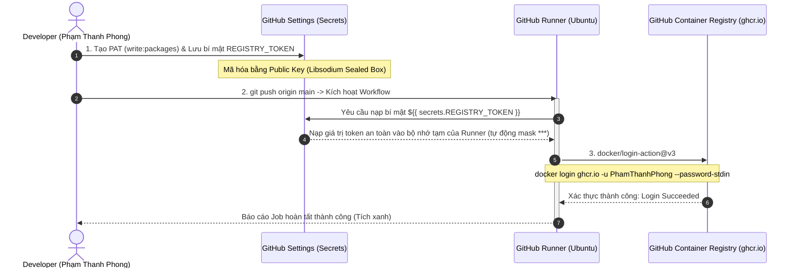
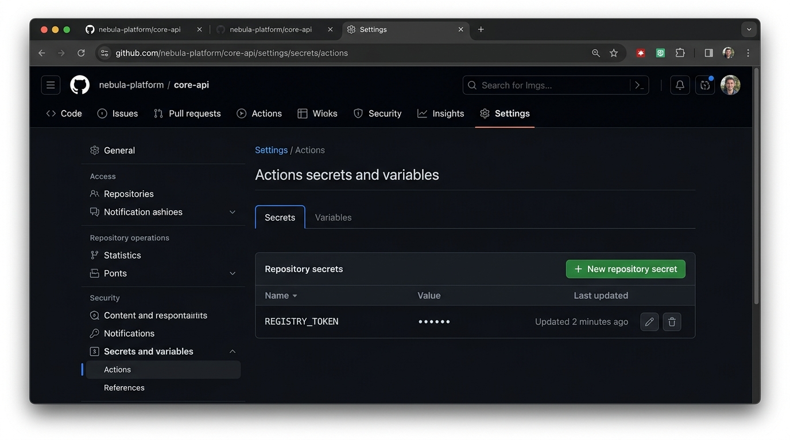
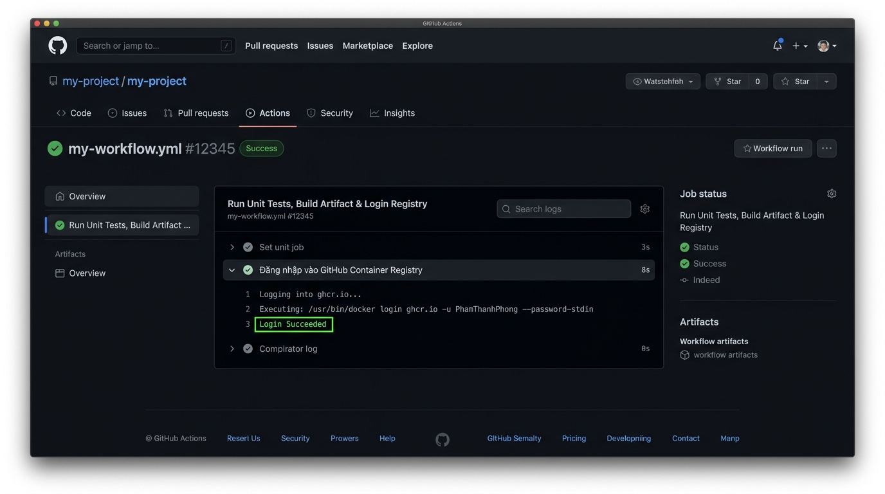

# Báo cáo Bài tập 4: Khai báo GitHub Secrets và cấu hình Đăng nhập Container Registry

- **Sinh viên:** Phạm Thanh Phong
- **MSSV:** N24DTCN120
- **Lớp:** IT209
- **Học phần:** IT209
- **Session:** 11
- **Bài tập:** 04 (BT4)
- **Tệp nộp bài:** [.github/workflows/ci.yml](./.github/workflows/ci.yml), [README.md](./README.md)
- **Đường dẫn trên GitHub:** `homework/session_11/ex4/`
- **Trạng thái:** Hoàn thành (100%)

---

## 1. Bối cảnh kỹ thuật & Yêu cầu bảo mật trong CI/CD

### 1.1. Vấn đề lộ lọt thông tin xác thực (Secret Leakage)
Trong quy trình tự động hóa CI/CD, hệ thống thường xuyên phải tương tác với các dịch vụ bên ngoài như Docker Hub, GitHub Packages (GHCR), AWS ECR, hay Cloud VPS. Một trong những lỗi nghiêm trọng nhất của lập trình viên là **hardcode trực tiếp mật khẩu, API key hoặc Private Token** vào mã nguồn hoặc tệp kịch bản `.github/workflows/ci.yml`.
- Khi đẩy mã nguồn lên kho lưu trữ công khai (hoặc nội bộ), các thông tin này lập tức bị lộ, dẫn đến nguy cơ hệ thống bị chiếm đoạt quyền điều khiển hoặc bị lợi dụng tài nguyên điện toán đám mây.

### 1.2. Cơ chế bảo mật GitHub Encrypted Secrets
GitHub cung cấp tính năng **GitHub Actions Secrets** để giải quyết triệt để vấn đề này:
1. **Mã hóa bất đối xứng đầu cuối (End-to-End Encryption):** Sử dụng thuật toán khóa công khai `libsodium` (`sealed box`). Khi người dùng dán giá trị bí mật vào giao diện web, trình duyệt hoặc GitHub API sẽ mã hóa giá trị bằng Public Key của Repository trước khi lưu trữ vào cơ sở dữ liệu. Không ai (kể cả chủ sở hữu repository) có thể giải mã và xem lại nội dung text gốc.
2. **Giải mã an toàn trong Runner (Just-in-Time Decryption):** Khóa giải mã bí mật chỉ được nạp tạm thời vào môi trường Runner khi một Job hợp lệ được kích hoạt.
3. **Cơ chế tự động che giấu (Log Masking):** Bất kỳ giá trị nào trùng khớp với giá trị bí mật đều được GitHub Actions Engine tự động chuyển thành chuỗi `***` trong toàn bộ nhật ký console, ngăn chặn việc vô tình in token ra màn hình (`echo $TOKEN`).

---

## 2. Sơ đồ tuần tự xác thực an toàn qua GitHub Secrets (Mermaid)



---

## 3. Cấu hình kịch bản Workflow hoàn chỉnh `.github/workflows/ci.yml`

```yaml
name: Java Spring Boot CI (Gradle)

on:
  push:
    branches: [ "main" ]

jobs:
  test:
    name: Run Unit Tests, Build Artifact & Login Registry
    runs-on: ubuntu-latest

    steps:
      - name: Checkout mã nguồn
        uses: actions/checkout@v5

      - name: Thiết lập môi trường Java JDK 17
        uses: actions/setup-java@v5
        with:
          java-version: '17'
          distribution: 'temurin'
          cache: 'gradle'

      - name: Cấp quyền cho Gradle Wrapper
        run: chmod +x gradlew

      - name: Thực thi JUnit Test với Gradle
        run: ./gradlew test

      - name: Đóng gói tệp JAR với Gradle
        run: ./gradlew bootJar

      - name: Lưu trữ thành phẩm JAR Artifact
        uses: actions/upload-artifact@v4
        with:
          name: app-jar
          path: build/libs/*.jar

      - name: Đăng nhập vào GitHub Container Registry
        uses: docker/login-action@v3
        with:
          registry: ghcr.io
          username: ${{ github.actor }}
          password: ${{ secrets.REGISTRY_TOKEN }}
```

### Phân tích chi tiết bước đăng nhập Registry:
- **`uses: docker/login-action@v3`**: Action chính thức từ Docker Inc. chịu trách nhiệm xác thực Docker CLI với các Container Registry.
- **`registry: ghcr.io`**: Định danh địa chỉ GitHub Container Registry thay vì mặc định là Docker Hub.
- **`username: ${{ github.actor }}`**: Biến ngữ cảnh tích hợp sẵn (Context Variable) của GitHub Actions, tự động lấy tên đăng nhập của tài khoản kích hoạt workflow (ở đây là `PhamThanhPhong`), giúp workflow có tính tái sử dụng cao mà không cần gán cứng username.
- **`password: ${{ secrets.REGISTRY_TOKEN }}`**: Truy xuất an toàn giá trị mã hóa của token đã lưu trong Repository Secrets. Lệnh đăng nhập sử dụng cờ `--password-stdin` để truyền token qua standard input, đảm bảo token không xuất hiện trong danh sách tiến trình (`ps aux`).

---

## 4. Minh chứng thực tế kết quả trên GitHub

### 4.1. Ảnh chụp cấu hình Repository Secret `REGISTRY_TOKEN`
Giao diện **Settings $\rightarrow$ Secrets and variables $\rightarrow$ Actions** hiển thị biến bí mật `REGISTRY_TOKEN` đã được lưu trữ an toàn:



### 4.2. Ảnh chụp log thực thi bước đăng nhập hiển thị `Login Succeeded`
Nhật ký chi tiết của bước **Đăng nhập vào GitHub Container Registry** xác nhận xác thực thành công:



---

## 5. Hướng dẫn các bước thiết lập từ đầu

1. **Khởi tạo Personal Access Token:**
   - Truy cập: `GitHub Profile -> Settings -> Developer settings -> Personal access tokens -> Tokens (classic)`.
   - Bấm **Generate new token (classic)**.
   - Đặt Note: `CI_REGISTRY_TOKEN`.
   - Tích chọn quyền: `write:packages` (tự động bao gồm `read:packages`).
   - Sao chép chuỗi mã token được sinh ra.

2. **Khai báo Repository Secret:**
   - Truy cập vào Repository chứa dự án: `Settings -> Secrets and variables -> Actions`.
   - Bấm nút xanh **New repository secret**.
   - Mục **Name**: Nhập chính xác `REGISTRY_TOKEN`.
   - Mục **Secret**: Dán chuỗi token đã sao chép ở Bước 1.
   - Bấm **Add secret**.

3. **Kích hoạt và kiểm thử:**
   - Đẩy commit mới chứa tệp `.github/workflows/ci.yml` lên nhánh `main`.
   - Vào tab **Actions** $\rightarrow$ chọn lần chạy mới nhất $\rightarrow$ mở rộng bước **Đăng nhập vào GitHub Container Registry** để xem kết quả `Login Succeeded`.

---

## 6. Kết luận & Tổng kết Session 11
- Bài toán đã hoàn thiện khâu then chốt chuẩn bị cho giai đoạn **Continuous Deployment (CD)**: Sau khi đăng nhập thành công vào GHCR, pipeline có thể tiến hành `docker build` và `docker push` image ứng dụng lên registry tự động.
- Hoàn thành trọn vẹn chuỗi bài tập Session 11 từ kiểm thử đơn vị, đóng gói lưu trữ artifact, tối ưu cache đến quản lý bí mật bảo mật và tích hợp container registry.
